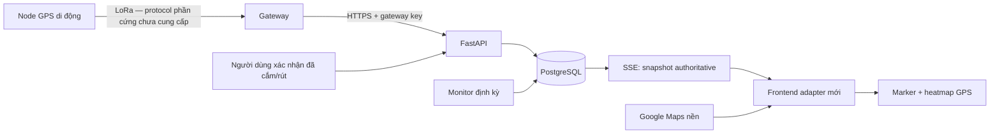
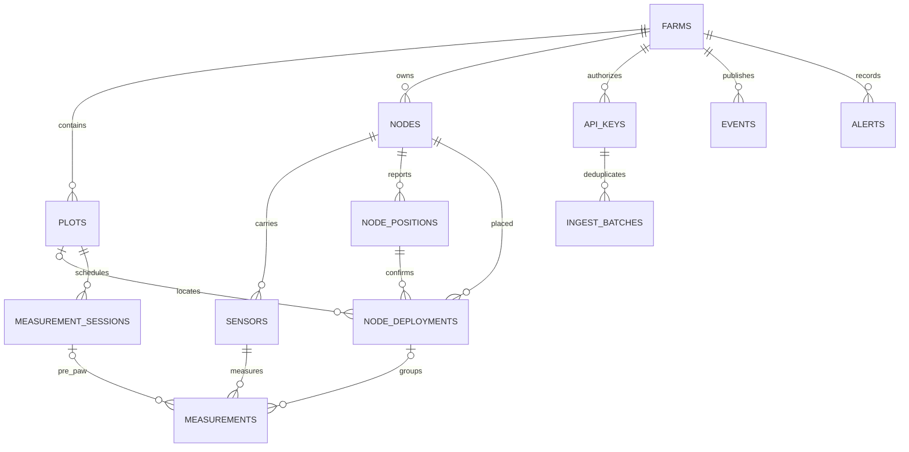

# Kiến trúc PAW — backend node di động

## Phạm vi và audit

Repository `PAW-Backend` trống khi bắt đầu. Không có FastAPI/database schema hay firmware cũ trong workspace được cung cấp. Đã đọc frontend thực tế tại `PAW-Frontend/paw-frontend/src`: domain, repository, API client, hooks và map/heatmap. Backend này định nghĩa API **mới phiên bản 1.0**, có OpenAPI sinh từ code và kiểm thử; không khẳng định đã xác minh hay thay thế ingest/ACK cũ. Frontend, FastAPI cũ, WPF và database hiện hữu không bị sửa.

Google Maps chỉ khởi tạo khi mở màn hình. Vị trí/số đo mới cập nhật layer, không khởi tạo lại nền. Kéo/zoom vẫn có thể tải thêm ảnh Google. Backend không gọi Google Maps, không cần Google key.

## ERD

## Lần đặt node

Node ID ổn định; một node có tối đa một deployment active. `active_node_id` unique và check constraint giữ invariant trong DB. Xác nhận cắm mới kết thúc lần đặt cũ trong cùng transaction. Xác nhận dùng GPS fix được chỉ định, thuộc node, mặc định không quá 300 giây và accuracy ≤25 m.

Point-in-polygon dùng Shapely, đúng thứ tự GeoJSON `[longitude, latitude]`, kiểm tra ring, holes, tự cắt, range ±85° Mercator. GPS nằm nhiều polygon → cần chọn plot rõ; ngoài tất cả plot → có marker nhưng plot null và không tham gia nội suy vùng. Sai số gần ranh giới vẫn cần người dùng xem lại; phép contains không phải xác nhận khảo sát.

Deployment cố định GPS đã xác nhận, không cập nhật theo jitter. GPS mới dịch chuyển xa hơn `max(15m, accuracy cũ + mới)` → latch `movement_detected_at`, `confirmation_required`, loại điểm khỏi heatmap cho tới khi xác nhận lần cắm mới. GPS hết hạn hoặc quay lại chỗ cũ không tự xóa latch. Gói GPS lịch sử trước deployment mới không kích hoạt latch cho vị trí mới.

GPS không chứng minh đầu dò đã cắm; giai đoạn này operator xác nhận. Sự kiện phần cứng tự phát hiện cắm/rút chỉ tích hợp sau khi xác minh cảm biến/công tắc và protocol.

## Thời gian và số đo

- API nhận thời gian có UTC offset; lưu UTC, xuất offset. Tách `observed_at` và `received_at`.
- Gateway phải giữ nguyên observed time, deployment ID và event ID qua retry; không thay GPS của gói buffer bằng GPS hiện tại.
- Không có deployment ID → lưu `moving`, plot null; không tự gán deployment hiện tại.
- Có deployment ID → thời điểm đo phải thuộc khoảng `[started_at, ended_at)` của chính node đó. Số đo gửi trễ vẫn thuộc vị trí cũ.
- `latest` theo observed time trong deployment đang hoạt động, không theo thời điểm đến. Chuyển node sang B không mang số đo A theo.
- Chờ ổn định mặc định 120 giây là giá trị thử nghiệm có cấu hình, cần hiệu chỉnh theo cảm biến thật.
- Giá trị hữu hạn ngoài giới hạn vật lý minh họa lưu `invalid`; NaN/Infinity bị từ chối. Raw ADC giữ đơn vị `raw`, không được xem là %/pH hoặc dùng cho heatmap. Calibration được chụp vào từng số đo.
- Mỗi sensor có metric, unit và depth. Độ sâu 20/40 cm trong simulator là dữ liệu mẫu; phần cứng khai báo theo lắp đặt thực. Không trộn hai độ sâu hoặc hai metric.
- `UNKNOWN` là mặc định. `PRE_PAW` chỉ khi client nêu session ID có thật, đúng farm/plot và khoảng thời gian; session có thể liên kết irrigation event cụ thể. Latest không đồng nghĩa PRE_PAW.

## Freshness và cảnh báo

Chu kỳ node mặc định 600 giây, có thể khai báo khi đăng ký. Số đo quá 2 chu kỳ → stale; node quá `max(PAW_OFFLINE_AFTER_SECONDS, 3*interval)` → offline. Heartbeat mới không làm số đo cũ thành mới. Gói buffered cũ không làm node vừa online. Chưa có heartbeat → unknown.

Snapshot luôn tính trạng thái theo thời gian server. Các cảnh báo đang có gồm unknown/delayed/offline, missing, stale, invalid, uncalibrated, stabilizing, moving/movement_detected và warning ngoài ngưỡng. Node rút khỏi deployment không tiếp tục đóng góp heatmap.

Các transaction ghi dữ liệu đồng thời reconcile lịch sử alert. Monitor chạy mặc định 15 giây để lưu các chuyển trạng thái do thời gian khi không có dữ liệu mới. Alert ghi thời gian phát hiện, resolved, acknowledged và người xác nhận; acknowledge không có nghĩa sự cố đã hết. Ngưỡng cấu hình là ngưỡng giám sát, không phải thuật toán khuyến nghị tưới.

## Transaction, ACK và SSE

- `(gateway_id,event_id)` unique. Cùng ID/cùng payload → cùng ACK, không thêm số đo/event. Cùng ID/khác payload → 409.
- Validate và ghi toàn batch trong một transaction, lỗi một sensor rollback tất cả. ACK `accepted` chỉ sau commit; đây là ACK HTTP mới, không phải thay đổi ACK LoRa cũ.
- PostgreSQL khóa row farm trước mọi thay đổi có event. Thứ tự event ID/cursor của farm không vượt qua transaction chưa commit. Snapshot cùng lock đảm bảo dữ liệu và cursor thống nhất.
- SQLite là chế độ thử đơn tiến trình, ghi đồng thời cao có thể trả 409/503; PostgreSQL dùng cho kiểm thử nhiều writer/triển khai sau nghiệm thu.
- SSE xác thực Bearer, gửi `event: snapshot`, `id: cursor`, `data: <SnapshotOut>`. Snapshot đầy đủ có thể gộp nhiều sự kiện; không hứa phát lại từng gói thô. Lịch sử thô nằm ở measurements.
- Reconnect bằng Last-Event-ID hoặc since; luôn nhận snapshot hiện tại authoritative, nên không mất trạng thái cuối khi API restart hoặc client mất mạng. Cursor lớn hơn DB hiện tại → 409, client bootstrap lại.
- Backend kiểm tra outbox/freshness mặc định mỗi giây; client không polling. Thay đổi trạng thái theo thời gian cũng đẩy snapshot dù cursor không đổi. Heartbeat SSE mỗi 15 giây.
- Key bị revoke → stream gửi `auth.revoked`, đóng trong vòng kiểm tra kế tiếp. Không truyền token trong URL. Với browser dùng `fetch` stream để có Authorization header, không dùng native EventSource với token query.

## Khả năng mở rộng và giới hạn

Mục tiêu ban đầu vài chục node, chưa benchmark tải lớn. Snapshot hiện dùng một số truy vấn theo node, lock theo farm và SSE poll DB mỗi connection. Trước khi scale cần đo tải, tối ưu query/fanout và cân nhắc broker; không cần thêm Redis để chạy phiên bản này. Events/measurements/alerts chưa có lịch retention tự động. Phải chốt thời gian lưu, backup/restore và quyền người dùng trước production.

Tách farm simulation/sensor, key theo vai trò và farm. Chưa có đăng nhập người dùng/OIDC; không phát admin/gateway key cho browser. API keys phù hợp thử nghiệm có kiểm soát; cần login/session/rotation và HTTPS/reverse proxy trước triển khai thật. Không bật CORS `*` hoặc mở cổng DB công khai.
