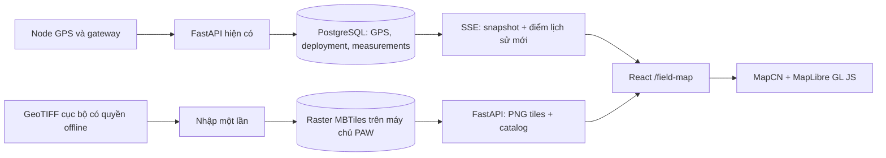

# PAW — MapLibre GL JS + MapCN + ảnh vệ tinh lưu tại máy chủ

Ngày triển khai: 17/11/2026. Tích hợp mới tại **`/field-map`**; các màn hình DEMO, Google/Leaflet, simulator, lịch sử và cảnh báo cũ vẫn giữ nguyên. Luồng mới chỉ chấp nhận farm nguồn `sensor`, không fallback sang fixtures hoặc vị trí sơ đồ.

## Audit và kiến trúc

Đã đọc source thật của cả PAW-Frontend và PAW-Backend. Backend lưu Position → Deployment → Measurement nên có thể khôi phục chính xác GPS lịch sử, không cần thêm bảng hoặc sửa dữ liệu. API snapshot cũ chỉ chứa latest của deployment active; bổ sung `/map-points` và opt-in `include_map_points=true` trên SSE để giữ các phép đo cũ khi node chuyển chỗ.



MapCN là subset có điều chỉnh từ source MIT chính thức, không phải một tên UI tự đặt. Xem `src/components/mapcn/README.md` và LICENSE để biết upstream/version. Đã loại style Carto và worker CDN mặc định; MapLibre worker/CSS được Vite đóng gói trong `dist/assets`. Style khởi tạo không có glyph/sprite/font/terrain bên ngoài. Raster chỉ đến từ catalog máy chủ PAW, tile request mang Bearer token cho đúng origin.

`Map` khởi tạo trong effect vòng đời một lần cho mỗi lần mở/kết nối màn hình; cleanup khi rời màn hình hoặc người dùng đổi kết nối. Render lại, SSE, đổi thông số, chọn điểm, bật/tắt heatmap chỉ gọi `GeoJSONSource.setData`/paint/layout. Không gọi `new Map`/`setStyle` cho số đo mới. Đổi bộ ảnh do người dùng mới thay raster source/layer. Pan/zoom vẫn có thể đọc tile nội bộ khác hoặc cache; không phải cam kết chỉ có một HTTP request ảnh suốt phiên.

## Chạy trong mạng nội bộ không có Internet

1. Trên máy có Internet, cài/build frontend và cài backend dependencies một lần; sau đó chuyển đủ build và dependencies/image container vào máy chủ LAN. Cần Python 3.12 và Node tương thích frontend nếu build tại chỗ.
   Để cài Python trên máy không có Internet, tải wheel trước trên cùng OS/Python đích bằng `python -m pip download -r requirements.txt -d wheels`, chuyển thư mục wheels rồi dùng `python -m pip install --no-index --find-links wheels -r requirements.txt`. Dependency nhập ảnh dùng requirements-imagery.txt tương tự; runtime không cần tải thêm.

2. Backend: tạo `.env`, migration như README. Không seed dữ liệu mô phỏng vào farm thật.
3. Frontend:

```powershell
Set-Location 'C:\PAW\PAW-Frontend\paw-frontend'
npm ci
npm run build
```

4. Trong `.env` backend:

```dotenv
PAW_FRONTEND_DIST=C:/PAW/PAW-Frontend/paw-frontend/dist
PAW_IMAGERY_DIR=C:/PAW/data/imagery
```

5. Chạy backend từ thư mục backend:

```powershell
.\.venv\Scripts\python.exe -m uvicorn app.asgi:app --host 0.0.0.0 --port 8000
```

Mở `http://<IP-may-chu-PAW>:8000/field-map` trên PC/điện thoại cùng LAN. Cho phép cổng này trên Windows Firewall mạng riêng. DB và gateway token không mở cho browser. Nếu truy cập qua mạng không tin cậy, dùng HTTPS/reverse proxy; không đưa token vào URL hoặc biến VITE.

Trang kết nối nhập origin máy chủ (mặc định cùng origin), farm ID và **viewer/operator token** cấp bằng API sẵn có. Token chỉ nằm trong bộ nhớ phiên, không lưu localStorage hoặc nhúng bundle; refresh cần nhập lại. Khi dùng cùng origin, không cần thay CORS. Nếu chạy frontend riêng cổng, thêm chính xác origin vào PAW_CORS_ORIGINS. SSE proxy cần tắt buffering và cho phép kết nối dài.

Không dùng `navigator.onLine` để chặn LAN khi mất WAN. Không gọi Google/OSM/Carto/MapCN registry lúc vận hành. Backend phục vụ index, assets, worker, catalog và tile từ ổ đĩa LAN. Đây là **offline Internet**, không phải PWA chạy khi mất luôn máy chủ LAN. Không cần service worker để mở lạnh từ máy chủ đang hoạt động trong LAN.

### Docker tùy chọn

Sau khi build frontend và nhập ảnh trên host:

```powershell
$env:PAW_FRONTEND_BUILD_DIR = 'C:/PAW/PAW-Frontend/paw-frontend/dist'
$env:PAW_IMAGERY_HOST_DIR = 'C:/PAW/data/imagery'
docker compose -f compose.yaml -f compose.offline.yaml up --build -d
```

Overlay mount build/ảnh read-only, không nhúng dữ liệu ảnh hoặc credentials vào image. Compose gốc chỉ bind API loopback; để dùng từ thiết bị khác trong LAN, quản trị viên đổi port binding sang IP LAN cụ thể của máy chủ và mở Windows Firewall mạng riêng. Không mở PostgreSQL ra LAN.

## Nhập ảnh một lần, giữ lâu dài

**Chưa được cung cấp GeoTIFF, raster tiles, giấy phép hoặc AOI của khu đất. Repository không chứa và không tự tải ảnh vệ tinh thay thế.** Khi chưa cài ảnh, trang hiển thị thông báo rõ, nền màu trung tính và GPS thực nếu có; không gọi đó là ảnh vệ tinh.

Nguồn phù hợp có thể là GeoTIFF đã tải từ chương trình ảnh có quyền sao chép/phục vụ offline, ảnh drone tự sở hữu, hoặc nhà cung cấp có thỏa thuận phù hợp. Quyền xem tile trên Internet không mặc nhiên là quyền tải/lưu lâu dài. Không tải Google/Bing/Esri/OSM tile hàng loạt khi chưa có quyền. Với Sentinel/Landsat, cần chọn scene/AOI và xử lý band/độ phân giải theo metadata thực; chưa chọn scene vì chưa có phạm vi đất.

Lưu file gốc và bản giấy phép ở nơi quản trị. Chạy trên máy nhập ảnh, không bắt buộc cài GDAL CLI:

```powershell
.\.venv\Scripts\python.exe -m pip install -r requirements-imagery.txt
.\.venv\Scripts\python.exe -m app.import_imagery 'C:\PAW\source\anh-co-quyen.tif' --id farm-2026-v1 --farm-id FARM-ID --license 'Ten giay phep / hop dong' --license-url 'https://dia-chi-giay-phep' --attribution 'Chu so huu / Nguon anh' --offline-rights-confirmed --min-zoom 12 --max-zoom 18 --bands 1 2 3 --output-dir 'C:\PAW\data\imagery'
```

- File phải là GeoTIFF có CRS; band phải đúng theo nguồn. Không mặc định band 1/2/3 là RGB cho mọi sản phẩm vệ tinh.
- Ảnh 8-bit RGB có thể nhập trực tiếp. Ảnh 16-bit/reflectance cần khai báo `--value-range MIN MAX` đúng metadata/visualization mong muốn, ví dụ **chỉ nếu nguồn quy định** khoảng 0–10000 thì dùng `--value-range 0 10000`. Không tự scale tùy từng tile gây sai màu.
- Chọn zoom theo độ phân giải nguồn; phóng to quá mức không tạo thêm chi tiết. Import có `--max-tiles` mặc định 20000, dừng trước khi ghi nếu vượt. Cắt AOI trước bằng công cụ GIS nếu ảnh quá lớn.
- Công cụ reprojection sang Web Mercator, tạo PNG 256px trong MBTiles (TMS lưu nội bộ; API chuyển XYZ), lưu bounds, zoom và hồ sơ giấy phép trong metadata. Dữ liệu raster không đưa vào PostgreSQL.
- Import tạo file tạm rồi publish nguyên bộ; không ghi đè dataset ID đang dùng. Dùng ID phiên bản mới khi thay ảnh và kết nối lại để đọc catalog rồi chọn bộ ảnh mới trong UI. Backup MBTiles và giấy phép riêng; mặc định `data/`/GeoTIFF/MBTiles không commit Git.
- Chỉ thao tác nhập cần rasterio/mercantile/Pillow; runtime phục vụ MBTiles chỉ cần SQLite/Python và backend hiện có. Không cần Google API key.

## Điểm đo và heatmap

Mỗi Measurement có ID ổn định. API `/v1/farms/{farm}/map-points` join deployment và position đã xác nhận để trả GeoJSON. Phép đo ở A vẫn giữ tại A sau khi node tới B. Payload gồm sensor/node, thời gian đo/nhận, metric/unit/depth, source/quality, phase/session, deployment và GPS accuracy. Gói không có deployment không có GPS đo đã xác nhận, nên không được tự đặt vào bản đồ theo vị trí hiện tại.

Client bootstrap lịch sử phân trang `limit`/`after`, hợp nhất theo measurement ID. SSE bổ sung recent measurements theo received time (bao gồm gói gửi trễ), không xóa các điểm lịch sử đã tải. Reconnect tải lại các trang để khôi phục khoảng bỏ lỡ. SSE snapshot giới hạn 10000 điểm gần nhất; không phải cơ chế replay không giới hạn. Với tốc độ lớn hơn 10000 phép đo giữa hai lần nhận, cần phân trang đồng bộ lại/giảm khoảng thời gian; chưa benchmark tải lớn hoặc triển khai kho sự kiện chuyên biệt.

Marker điểm lịch sử chỉ lọc theo chỉ tiêu/độ sâu; popup có số đo, GPS, lần cắm và thời gian. Danh sách điểm hỗ trợ chọn bằng bàn phím. Node hiện tại hiển thị riêng với connectivity. Chất lượng/history không bị coi là phép đo mới.

Heatmap mặc định chỉ dùng `snapshot.heat_points`: active placement, đã ổn định, được hiệu chuẩn, chưa stale/offline, đúng metric/depth. Heatmap MapLibre là **cường độ tương đối có trọng số theo giá trị**, không phải nội suy IDW/kriging định lượng hay khuyến nghị tưới; chú giải Thấp→Cao không khẳng định mọi pixel là số đo nhiệt độ/pH. Ngắt SSE làm tắt lớp heat hiện tại để tránh diễn giải dữ liệu cũ như đang cập nhật; các điểm lịch sử vẫn giữ.

## Kiểm thử và giới hạn nghiệm thu

Các fixture GPS/pixel trong tests được tạo trong database/thư mục tạm, ghi nhãn TEST ONLY, không phải dữ liệu vận hành hay ảnh vệ tinh thật. `app.asgi` không seed bất kỳ dữ liệu nào. Bộ E2E dùng production Vite build do FastAPI phục vụ, chặn tất cả HTTP origin ngoài máy chủ LAN thử nghiệm, dùng MapLibre/WebGL thật và worker local.

Backend:

```powershell
.\.venv\Scripts\python.exe -m pip install -r requirements-dev.txt
.\.venv\Scripts\python.exe -m pytest -q
```

Frontend: typecheck/lint/test/build và E2E cũ như README. Bộ offline riêng cần test fixture server (không chạy trên database thật):

```powershell
# Backend terminal; thư mục tạm mới cho mỗi lượt chạy
$env:PAW_E2E_DIR = 'C:\PAW\tmp\offline-test-1'
$env:PAW_E2E_FRONTEND_DIST = 'C:\PAW\PAW-Frontend\paw-frontend\dist'
.\.venv\Scripts\python.exe tests/offline_e2e_server.py
# Frontend terminal
$env:PAW_E2E_CREDENTIALS = 'C:\PAW\tmp\offline-test-1\credentials.json'
npx playwright test -c playwright.offline.config.ts
```

Chỉ chạy fixture server loopback, không dùng keys/data test làm cấu hình vận hành. Kết quả cuối được ghi ở báo cáo bàn giao. Chưa có ảnh vệ tinh khu đất và GPS thiết bị thật để nghiệm thu độ phủ, độ chính xác hay chất lượng màu ảnh. Không tuyên bố đã hoàn thành việc nhập ảnh thật khi chưa có nguồn/phạm vi/giấy phép.
