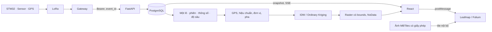
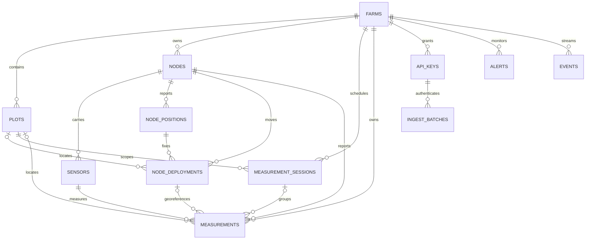

# Bàn giao nhánh nâng cấp Leafmap và PostgreSQL

Nhánh `upgrade/leafmap-spatial` dùng `e507e2f` làm mốc đối chiếu. Trước khi thử ở đồi chè, triển khai trên bản sao của database và nhập bộ ảnh đúng tọa độ, có giấy phép lưu nội bộ. Kết quả đo hiệu năng và số liệu khoa học dưới đây có nguồn khác nhau.

## Luồng dữ liệu và thay đổi so với bản ban đầu

| Thành phần | Hiện trạng kiểm tra tại mốc gốc | Hành vi trên nhánh này |
|---|---|---|
| Gateway | Ingest dùng Bearer theo farm, ACK theo gateway/event_id và hash nội dung. | Giữ giao thức, transaction và xác thực. Cho phép gửi NULL khi đầu dò lỗi và thêm chỉ tiêu bức xạ. |
| PostgreSQL | GPS được lưu riêng theo thời gian, số đo tham chiếu lần cắm. Giá trị bắt buộc khác NULL. | Một migration nới ràng buộc value. Dùng lại quan hệ lần cắm để dựng lịch sử và tập nội suy. |
| API đọc | Viewer bootstrap theo mạng/origin/farm. Snapshot/SSE và API lịch sử có sẵn. | Thêm GET /v1/farms/{farm_id}/leafmap và /surface. Cùng quyền viewer/operator theo farm, admin quản trị riêng. |
| Bản đồ | React khởi tạo MapLibre/MapCN, xử lý heat layer ở phía trình duyệt. | FastAPI tạo tài liệu Leafmap. Một iframe cho mỗi màn hình bản đồ. React gửi dữ liệu qua postMessage có kiểm tra origin và cửa sổ. |
| GIS | Tile PNG từ bộ MBTiles nội bộ, có trình nhập GeoTIFF. | Giữ quyền ảnh và tile API. JS/CSS/biểu tượng của renderer được phục vụ từ /map-assets. |
| Tương tác | Lịch sử, cảnh báo, lựa chọn độ sâu, simulator và bootstrap không cần đăng nhập. | Giữ các luồng đang có. Phân biệt điểm cột hiện tại và dấu đo lịch sử, bật/tắt lớp ước tính. |
| Khởi động | Launcher khởi động server và mở trình duyệt mà chưa chứng minh database sẵn sàng. | Kiểm tra cấu hình, frontend build, kết xuất Leafmap, kết nối và phiên bản schema. Mở bản đồ sau readiness và viewer-bootstrap. |



**Chọn backend hiển thị.** Folium tạo tài liệu HTML và đối tượng bản đồ chạy độc lập trong trình duyệt, phù hợp FastAPI và SSE sẵn có. Backend ipyleaflet dùng widget/comm sẽ cần thêm runtime để đồng bộ Python và trình duyệt. Leafmap khởi tạo Folium một lần, ứng dụng chỉ truyền cập nhật layer. Leaflet 1.9.4 là renderer đi kèm tài liệu này. `leafmap` Python hiện kéo gói Python `maplibre` làm dependency bắc cầu. Không có MapLibre JS trong bundle React. [Leafmap](https://leafmap.org/) · [Mã nguồn foliumap](https://github.com/opengeos/leafmap/blob/master/leafmap/foliumap.py)

## Cấu trúc PostgreSQL



Mỗi bảng có khóa chính. Một node có tối đa một active_node_id đang cắm, các lần cắm cũ có thời điểm kết thúc. Bảng positions kiểm tra giới hạn tọa độ và accuracy > 0. Cặp gateway_id/event_id là duy nhất. API xử lý số đo, sự kiện và ACK trong một transaction, gửi lại cùng payload nhận cùng ACK. Tọa độ lịch sử lấy qua deployment_id. Gateway được biểu diễn bằng khóa có role gateway. Ảnh ở tệp MBTiles, raster ước tính ở cache RAM theo dữ liệu đầu vào. Xem chi tiết cột, FK, check và index trong [models.py](../backend/app/models.py).

**Python GIS và PostGIS.** Truy vấn hiện thu hẹp theo farm, lô, chỉ tiêu, độ sâu và thời gian trước khi chiếu tọa độ. Với hai cột và giới hạn mỗi phiên, Python/PyProj/Shapely đủ để tính khoảng cách mét và mask. PostGIS đáng thử nếu cần tìm lân cận qua nhiều lô hoặc tìm polygon chứa hàng triệu vị trí. Khi đó có thể dùng geometry SRID 4326, GiST, ST_Intersects/ST_Within và ST_DWithin trên geography hoặc geometry đã ST_Transform sang CRS mét. Kiểm tra đơn vị của ST_Distance trước khi so sánh. PostGIS đòi cài extension tương thích phiên bản PostgreSQL trên mỗi máy Windows và migration/index riêng. Chưa có benchmark A/B chứng minh lợi ích tại PAW nên phiên bản này dùng PostgreSQL thường.

## Chẩn đoán và vận hành trên Windows

Chạy cài đặt lần đầu theo [README](../README.md). Để cập nhật một máy đã cài, dừng launcher và monitor, sao lưu database bằng pg_dump định dạng custom, sao lưu .env và thư mục ảnh với quyền truy cập hạn chế. Thử pg_restore vào **database nghiệm thu riêng** trước khi tác động lên hệ thống thật. Trong bản checkout sạch, chạy:

```powershell
git fetch origin
git switch upgrade/leafmap-spatial
git pull --ff-only
Set-Location frontend
npm ci
npm run build
Set-Location ..\backend
.\.venv\Scripts\python.exe -m pip install -r requirements-imagery.txt
.\.venv\Scripts\python.exe -m alembic current
.\.venv\Scripts\python.exe -m alembic upgrade head
..\Start-PAW.cmd
```

Launcher đặt thư mục làm việc là backend. Cấu hình máy chủ sử dụng PAW_DATABASE_URL, PAW_ADMIN_TOKEN và viewer grant. Có thể đưa mật khẩu riêng vào PAW_DB_PASSWORD để SQLAlchemy tự mã hóa ký tự dành riêng. Chỉ quản trị viên và tài khoản chạy máy chủ được đọc .env. Khách LAN dùng URL được bàn giao. Khi chỉ thiếu viewer grant, launcher báo trạng thái và địa chỉ quản trị, server vẫn chạy để quản trị viên chuẩn bị farm. Khi mất Internet, các tài nguyên đã cài tiếp tục được cấp qua LAN. Khi mất cả LAN, trang giữ dữ liệu đã tải trong bộ nhớ đến khi kết nối lại. Tile chưa từng tải cần truy cập máy chủ.

| Triệu chứng | Phân biệt nguyên nhân | Kiểm tra / hành động quản trị |
|---|---|---|
| /health 200, /ready 503 | Tiến trình FastAPI còn sống, DB hoặc schema chưa sẵn sàng | Get-Service *postgres*; Test-NetConnection 127.0.0.1 -Port 5432. Kiểm tra tên instance, cổng, cấu hình listen và log PostgreSQL. |
| Mật khẩu sai / database sai | Đã tái hiện hai lỗi độc lập. psycopg có thể không cấp SQLSTATE lúc bắt tay. | Dùng psql -h HOST -p PORT -U USER -d DB -W với đúng tài khoản dịch vụ. Xác minh dbname, username và secret trước khi kiểm tra quy tắc pg_hba.conf theo thứ tự. |
| /ready 503 sau đổi schema | Database trống hoặc revision chưa ở head. SQLSTATE 42501 khi thiếu quyền bảng. | So sánh alembic current và heads trong backend. Dùng role triển khai được DDL khi migration. Role ứng dụng cần CONNECT, USAGE schema, DML bảng và sequence tương ứng. |
| /v1/viewer-bootstrap 403 | Viewer grant bị từ chối trước khi đọc farm | Đối chiếu IP thực tế, Host/origin gồm giao thức và cổng, PAW_VIEWER_NETWORKS, PAW_VIEWER_ORIGINS, PAW_VIEWER_FARM_ID. 401 ở endpoint bảo vệ thường do Bearer thiếu/hết quyền. |
| Bootstrap trả 503 dù /ready 200 | Có quyền mạng nhưng farm chưa tồn tại hoặc source khác sensor | Kiểm tra farm đã bàn giao trong đúng database. |
| Trình duyệt báo fetch/CORS hoặc 404 | Có thể do cấu hình origin hoặc URL frontend/backend | Dùng cùng origin khi triển khai. Kiểm tra URL/status ở Network, VITE_PAW_API_URL tại lúc build, route /v1 và dist/index.html. |
| Pool timeout | Hết kết nối sẵn có trong thời gian chờ | Kiểm tra pg_stat_activity, transaction chờ khóa, idle in transaction và số process. Mặc định 4 kết nối thường + 2 overflow/process, chờ 8 s, recycle 1800 s, connect timeout 5 s và pre-ping. Tính cả process monitor, worker và kết nối quản trị trong max_connections. |
| Không thấy ảnh / chỉ thấy điểm | Thiếu bộ ảnh, thiếu quyền sử dụng hoặc chưa đủ vị trí theo phiên | Kiểm tra catalog/active và bounds ảnh. Kiểm tra GPS, hiệu chuẩn, session_id, depth, thời gian và diện tích bao lồi. |

Lỗi tạm thời lúc DB khởi động lại hoặc pool bận cho phép retry sau backoff. Gateway gửi lại cùng event_id và payload. Lỗi mật khẩu, quyền và phiên bản schema cần sửa cấu hình. Chưa nhận được traceback sản xuất hoặc log Windows của lần xảy ra lỗi ban đầu. Các trường hợp tái hiện trong bảng là phép thử độc lập.

## Migration và khôi phục

Revision `12dfcadb8600` sau `81793dd71919` chỉ cho phép NULL tại measurements.value. Khi ingest giá trị NULL, quality là invalid. Dữ liệu đã có vẫn giữ nguyên. Downgrade kiểm tra sự tồn tại của NULL trước khi khôi phục NOT NULL. Nếu đã có NULL, giữ database mới, sao lưu cả số đo mới, và diễn tập khôi phục bản sao trước nâng cấp trên database riêng để tránh mất phép đo. Chọn bản ứng dụng tương thích với schema đã nghiệm thu. Chưa chạy migration trên database của người dùng.

## Kiểm thử và benchmark

Thử trên Linux với Python 3.12, Chromium, PostgreSQL riêng và các database test dùng một lần. Không dùng khóa Gateway, ảnh vệ tinh hoặc số đo của trang trại.

| Phép thử | Kết quả quan sát |
|---|---|
| Backend, gồm auth/scope, hồi quy ingest/ACK, transaction, alert, SSE/cursor, GPS, calibration, NULL và nội suy | 50 test đạt trên PostgreSQL; 50 test đạt trên SQLite fixture cách ly. Có cảnh báo deprecation từ Starlette TestClient/httpx. |
| Launcher và static serving | Chạy scripts/launch.py trên Linux với PostgreSQL tạm đã migration, dist thật và viewer grant. /ready, /v1/viewer-bootstrap, /map, tài liệu Leafmap và imagery/active đều trả 200. Kiểm tra lockfile có wheel Windows x64 cho CPython 3.12 của NumPy, SciPy, Rasterio, PyProj, Pillow, Shapely và psycopg-binary. |
| Alembic trên PostgreSQL | upgrade head, check, downgrade một revision và upgrade lại thành công trên database tạm. |
| Fault injection PostgreSQL riêng | Sai mật khẩu, thiếu database, thiếu migration, thiếu SELECT và dừng service đều cho /ready 503. Sau restart, cùng app/pool trả 200. /health vẫn 200 khi DB dừng. Thiếu grant cho viewer trả 403. |
| React | TypeScript, ESLint, 58 unit/integration test và Vite production build đạt. |
| Playwright | 12 test điều hướng/simulator trên 4 viewport đạt. 4 ca Chromium tích hợp FastAPI trên desktop 1366 và mobile 360 đạt. |
| Offline/GIS tích hợp | Chặn mọi origin ngoài máy chủ. Tải tile nội bộ, nhấn marker, tắt/bật lớp, chuyển offline/reconnect và khôi phục lịch sử. Đến vị trí thứ ba không thẳng hàng, raster xuất hiện với 3 vị trí. Cùng phần tử DOM bản đồ và mức zoom trước/sau cập nhật. Thiếu ảnh hiện đúng thông báo. |

**SQL.** EXPLAIN (ANALYZE, BUFFERS) sau ANALYZE trên 20.000 số đo tổng hợp cùng plot/metric/depth. Đọc 100 dòng mới nhất theo observed_at DESC, id DESC dùng Index Scan Backward trên ix_measurement_plot_time, 9 shared buffer hits, planning 0,353 ms, execution 0,096 ms trong lần đo. Chưa đo tải nhiều gateway đồng thời hoặc SSE kéo dài. Chưa bổ sung index vì chưa có bằng chứng cần thiết từ tải thật.

**Raster.** Đo thời gian bên trong engine với NumPy seed 548, một luồng BLAS, cùng lô 0,002° × 0,002°; ba lần bỏ cache cho mỗi kích thước. Dữ liệu tổng hợp chỉ dùng để đo chi phí tính toán.

| Vị trí | Mô hình chọn trong fixture | Ba lần chạy (ms) | Cache hit (ms) |
|---:|---|---|---:|
| 3 | IDW p=2 | 26,2 / 2,3 / 1,6 | 0,007 |
| 12 | IDW p=3 | 6,6 / 3,5 / 3,7 | 0,010 |
| 24 | OK Gaussian | 1301 / 1998 / 1837 | 0,015 |
| 48 | OK spherical | 265 / 182 / 197 | 0,020 |

Ở 24 vị trí, mỗi ứng viên phải fit lại 24 lần. Ở 48 vị trí sử dụng bốn block, giảm số lần fit. Các thời gian chưa bao gồm mạng, truy vấn DB hoặc render của trình duyệt.

## Phụ thuộc và danh mục thay đổi

Frontend gỡ maplibre-gl, MapCN wrapper và lớp SVG cũ. Backend thêm Leafmap/Folium, SciPy, PyProj, Pillow, Rasterio, sử dụng NumPy và Shapely. Bản khóa đã kiểm tra gồm Leafmap 0.64.7, Folium 1.0.0, SciPy 1.18.1, PyProj 3.8.0 và Rasterio 1.5.2. Tệp JS/CSS, ảnh biểu tượng và giấy phép BSD của renderer được lưu trong backend/app/map_assets. Xem phiên bản chính xác trong backend/uv.lock và frontend/package-lock.json.

Từ gốc repository, lệnh sau xuất danh sách đầy đủ file thêm (A), sửa (M), xóa (D) so với bản hợp nhất ban đầu, gồm migration, mã ứng dụng, assets, tests, dependency và tài liệu.

```powershell
git diff --name-status e507e2f..HEAD
git log --oneline e507e2f..HEAD
```

## Nghiệm thu còn lại

- Chạy Start-PAW.cmd trên máy Windows đích với tài khoản dịch vụ, PostgreSQL, ổ đĩa ảnh và firewall thực. Kiểm tra điện thoại vật lý và quyền viewer trong LAN.
- Xác nhận ảnh thật có CRS, license, tọa độ và phạm vi khớp khu đồi. Chưa có bộ ảnh hoặc đường biên thực địa của người dùng.
- Kiểm tra độ trễ STM32/LoRa, thời gian đồng bộ, độ sâu, định danh lần cắm và hiệu chuẩn bức xạ/độ ẩm. Thiết lập chu kỳ gửi từng node theo lịch thực tế để cảnh báo offline phù hợp khoảng nghỉ giữa các đợt.
- Ghi lịch mưa/tưới, địa hình và vị trí tham chiếu đồng thời. Với hai cột đo các chỉ tiêu khác nhau, một đợt thường chỉ đủ hiện điểm. Cần thiết kế đo lặp trước khi gộp nhiều thời điểm hoặc đánh giá RK. Nhánh này giữ RK ở mức adapter nghiên cứu. Cần tập nghiệm thu vị trí/thời gian độc lập để công bố sai số hoặc độ phủ của khoảng dự báo. Chưa tự động hóa việc xác định biến đồng hành có ích từ ảnh thực địa.

## Danh sách file của bản bàn giao

```text
M	README.md
M	Start-PAW.cmd
M	backend/.env.example
M	backend/README.md
M	backend/app/asgi.py
M	backend/app/config.py
M	backend/app/db.py
M	backend/app/main.py
A	backend/app/map_assets/LICENSE
A	backend/app/map_assets/bridge.js
A	backend/app/map_assets/images/layers-2x.png
A	backend/app/map_assets/images/layers.png
A	backend/app/map_assets/images/marker-icon-2x.png
A	backend/app/map_assets/images/marker-icon.png
A	backend/app/map_assets/images/marker-shadow.png
A	backend/app/map_assets/leaflet.css
A	backend/app/map_assets/leaflet.js
A	backend/app/maps.py
M	backend/app/models.py
M	backend/app/monitor.py
M	backend/app/responses.py
M	backend/app/schemas.py
M	backend/app/services.py
A	backend/app/spatial.py
M	backend/docs/openapi.json
A	backend/migrations/versions/12dfcadb8600_nullable_readings.py
M	backend/pyproject.toml
M	backend/requirements-dev.txt
M	backend/requirements-imagery.txt
M	backend/requirements.txt
A	backend/scripts/launch.py
M	backend/tests/conftest.py
M	backend/tests/offline_e2e_server.py
A	backend/tests/test_spatial.py
M	backend/uv.lock
A	docs/UPGRADE.md
A	docs/research/LITERATURE_REVIEW.md
A	docs/research/METHOD_COMPARISON.md
A	docs/research/REFERENCES.csv
A	docs/research/SPATIAL_INTERPOLATION.md
M	frontend/README.md
M	frontend/docs/screenshots/enduser-map-test-desktop-1366.png
M	frontend/docs/screenshots/enduser-map-test-mobile-360.png
M	frontend/e2e-offline/field-offline.spec.ts
M	frontend/package-lock.json
M	frontend/package.json
D	frontend/src/components/mapcn/LICENSE
D	frontend/src/components/mapcn/Map.tsx
D	frontend/src/components/mapcn/README.md
D	frontend/src/components/mapcn/context.ts
D	frontend/src/features/farm-map/HeatmapLayer.tsx
M	frontend/src/features/field-map/FieldMap.tsx
M	frontend/src/features/field-map/data.ts
M	frontend/src/features/field-map/types.ts
M	frontend/src/pages/FieldMapPage.tsx
M	frontend/src/styles/global.css
M	frontend/tests/field-map.test.tsx
```
